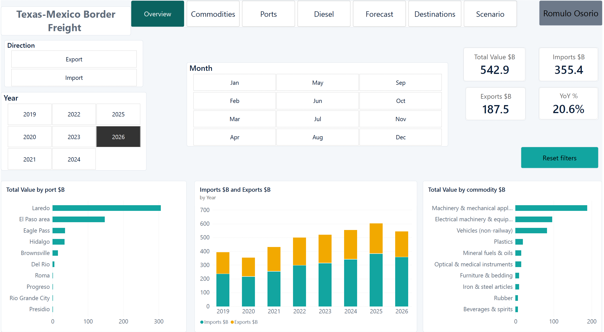
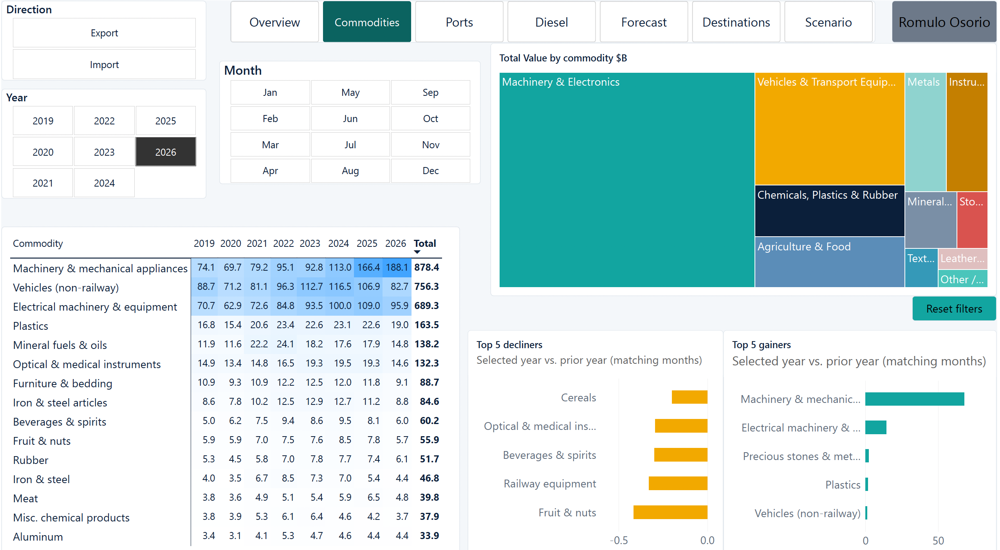
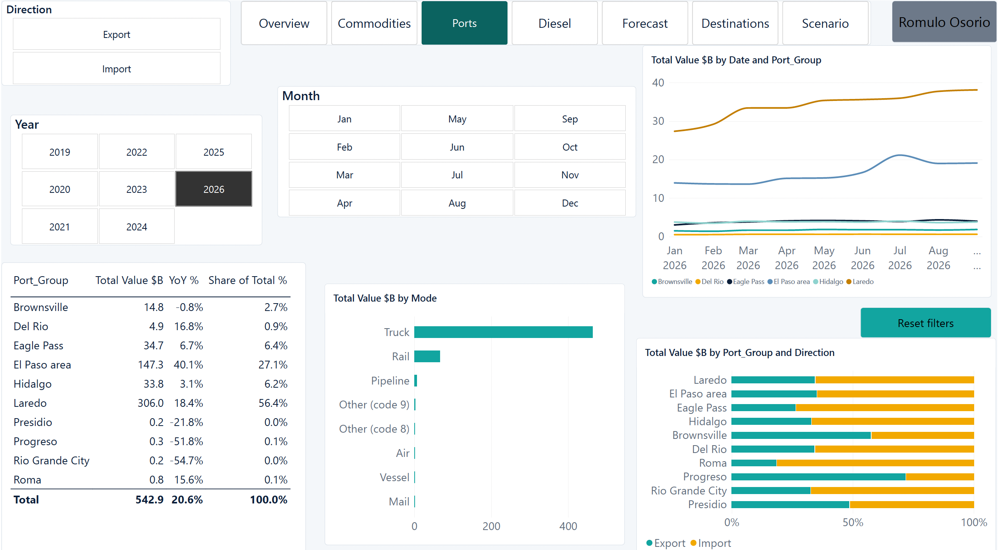
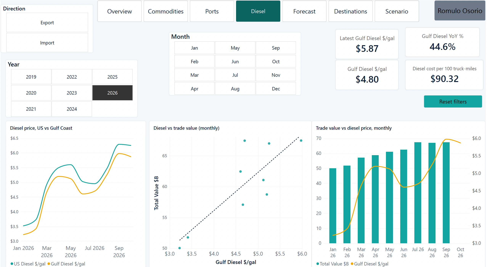
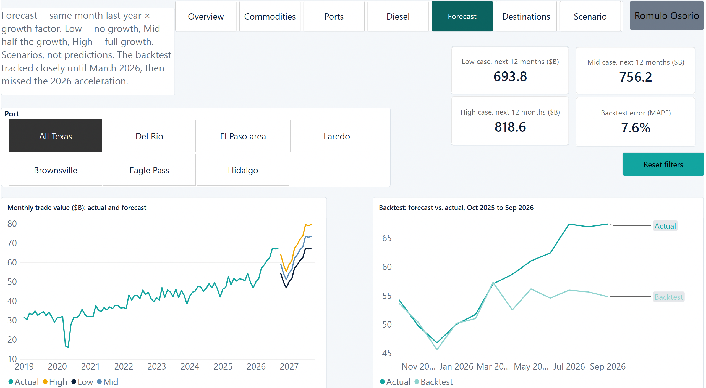
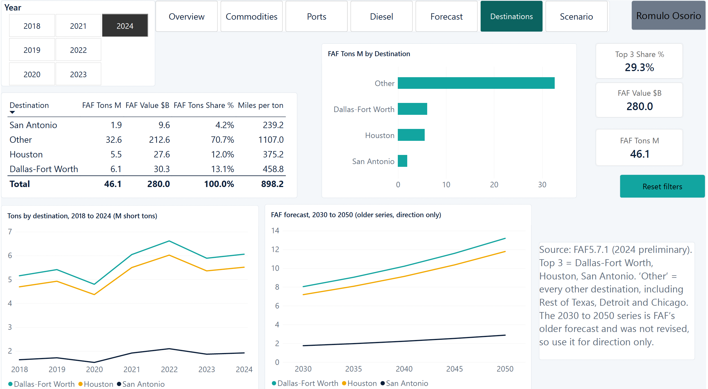
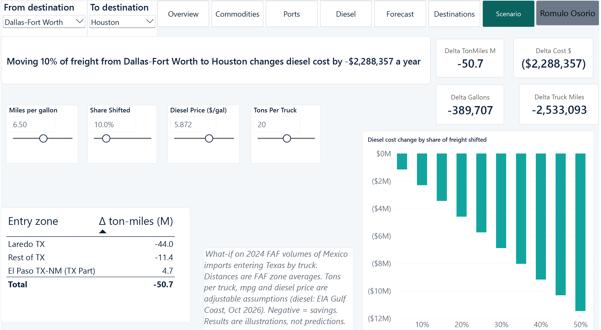

# Texas–Mexico Border Freight: Interactive Power BI Report

An interactive Power BI report on freight moving between Texas and Mexico: how much, through which ports and commodities, how diesel prices relate to it, what the next 12 months might look like, and what happens to diesel cost if freight is re-routed inside Texas.

**Live report:** https://app.powerbi.com/view?r=eyJrIjoiYTg0MTQwY2QtZDkwMC00YjYzLTg2OTgtYjJiMDllNzhiNjAxIiwidCI6IjUxNGVmZDQwLThlZmUtNGYxNS04MTlmLTM0ZTU2YWNmMTU2MiIsImMiOjN9

**Author:** Romulo Osorio · Supply chain and demand planning · Houston, TX · [LinkedIn](https://www.linkedin.com/in/romulo-osorio-mba-6bb61118b)

---

## Screenshots

## Screenshots

## What the report answers

| Page | Question |
|---|---|
| **Overview** | How big is Texas–Mexico freight, and how is it changing year over year? |
| **Commodities** | Which commodities drive the value, and which are gaining or declining? |
| **Ports** | Which Texas ports and transport modes carry the freight? |
| **Diesel** | How have diesel prices moved, and what does fuel cost per 100 truck-miles? |
| **Forecast** | What might the next 12 months look like (low / mid / high), and how accurate was the method in a backtest? |
| **Destinations** | Where does Mexico-origin freight entering Texas go inside the U.S.? |
| **Scenario** | If a share of freight is shifted from one destination to another, how do ton-miles, truck-miles, gallons and diesel cost change? |

Year, Month and Direction slicers are synced across the first four pages. Every page has a **Reset filters** button.

## Key findings

- **2025 trade value was $601.0B** (exports $220.2B, imports $380.8B), up **8.7%** from 2024.
- **January to September 2026 is $542.9B, up 20.6%** versus the same months of 2025.
- **Laredo handled about 57% of 2025 value** ($344.6B). The El Paso area grew fastest: +35.8% in 2025 and +40.1% in Jan–Sep 2026.
- **Machinery and mechanical appliances is the largest commodity group**, followed by vehicles and electrical machinery.
- **Diesel (EIA Gulf Coast)** averaged $3.33/gal in 2025 (−3.8%), then rose to about $4.80 in Jan–Oct 2026 (+44.6%). The latest reading (Oct 2026) is **$5.87/gal**, about **$90 of diesel per 100 truck-miles** at 6.5 mpg.
- **Next 12 months, all Texas ports:** $693.8B (low), $756.2B (mid), $818.6B (high). The method's backtest error (MAPE) is 7.6%.
- **FAF 2024 destinations:** 46.1M tons worth $280.0B. Dallas-Fort Worth (6.1M tons) and Houston (5.5M) are the largest named destinations; Dallas-Fort Worth, Houston and San Antonio together are 29.3% of tons.
- **Scenario example:** shifting 10% of freight from Dallas-Fort Worth to Houston cuts about 50.7M ton-miles, 2.53M truck-miles and 389,707 gallons, roughly **$2.29M of diesel a year**.

## Data sources

| Data | Source | Used for |
|---|---|---|
| TransBorder Freight (Jan 2019 – Sep 2026) | U.S. Bureau of Transportation Statistics | Trade value by port, mode, commodity and direction |
| Freight Analysis Framework, FAF5.7.1 | U.S. DOT / Oak Ridge National Laboratory | Destinations, tons, ton-miles, scenario |
| On-Highway Diesel Prices, U.S. and Gulf Coast (Jan 2019 – Oct 2026) | U.S. Energy Information Administration | Diesel page and scenario cost |

## Method

**Data preparation.** The raw files were cleaned and combined in Excel (lookup tables for ports, commodities and modes; pivot tables; a checks tab) before being loaded into Power BI. A Calendar table connects freight and diesel through one-to-many relationships.

**Year over year.** Compares the selected period with the same months of the prior year, so a partial year (Jan–Sep 2026) is never compared with a full year.

**Forecast.** Forecast = same month last year × growth factor *g*, where *g* = last 12 months ÷ the 12 months before. *Low* assumes no growth, *Mid* half of the growth, *High* the full growth. Accuracy is the backtest MAPE: All Texas 7.6%, Laredo 9.2%, El Paso area 8.7%, Eagle Pass 8.1%, Hidalgo 4.6%, Brownsville 10.5%, Del Rio 14.8%.

**Scenario (what-if).**
1. Shifted tons = share shifted × tons entering Texas for the "from" destination (FAF 2024, Mexico-origin, truck).
2. Miles per ton = FAF ton-miles ÷ tons, by entry zone, for each destination.
3. Change in ton-miles = shifted tons × (miles per ton to the new destination − miles per ton to the old one).
4. Truck-miles = ton-miles ÷ tons per truck; gallons = truck-miles ÷ miles per gallon; cost = gallons × diesel price.

Default assumptions: 20 tons per truck, 6.5 mpg, $5.871/gal (EIA Gulf Coast, Oct 2026; the slider shows $5.872). All three are adjustable. Negative values are savings.

## Limitations

- The **2024 FAF values are preliminary estimates**, and the **2030–2050 FAF forecast is an older series that was not revised**. Use it for direction only.
- The **forecast is a simple scenario method, not a prediction**. It extends recent growth and does not model tariffs, exchange rates or the economy.
- The **scenario is an illustration**. It uses zone-average distances and fixed assumptions for trucks, mpg and diesel price, and does not model routing, capacity or price changes.
- **Jan–Sep 2026 is a partial year.** Compare it only with the same months of earlier years (the YoY cards already do).
- Trade values are as reported by BTS (current dollars, not adjusted for inflation).
- TransBorder mode codes 8 and 9 are shown as **"Other (code 8 / 9)"** and are not interpreted.
- The report is published with Publish to web, so it is public. It contains no private data.

## Files

- `README.md`: this file
- `Texas_Mexico_Freight_Clean.xlsx`: cleaned Excel workbook (data, pivots, forecast, backtest, scenario calculator and checks)
- `EIA_Diesel_Monthly.csv` and `FAF_TX_Entry_Mexico_Truck.csv`: data files used by the report
- `Texas_Mexico_Border_Freight.pdf`: PDF export of the report
- `01_overview.png` to `07_scenario.png`: page screenshots

Raw source data is not included. Download it from the sources listed above.
## Tools

Power BI Desktop (DAX, Calendar table, what-if parameters, synced slicers, page navigation) · Excel (SUMIFS, pivot tables, data validation) · Public data from BTS, ORNL/FAF and EIA.
